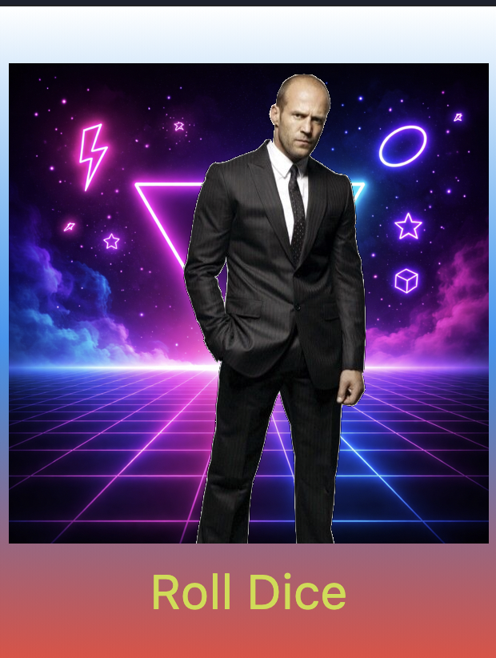

# Лабораторная работа 4-5 Flutter: структура UI и компонентный подход

**Козубенко Елена**  
**ИСП-241**  
**12.10.2026**  

## Что изучили
- Работа со своими изображениями.
-  Корректировка размера вставленных изображений
- Создание отдельных переменных для более понятного и краткого использования их в виджетах

[ссылка на репозиторий в GitHub](https://github.com/MorastGit/lab4_flutter_app)